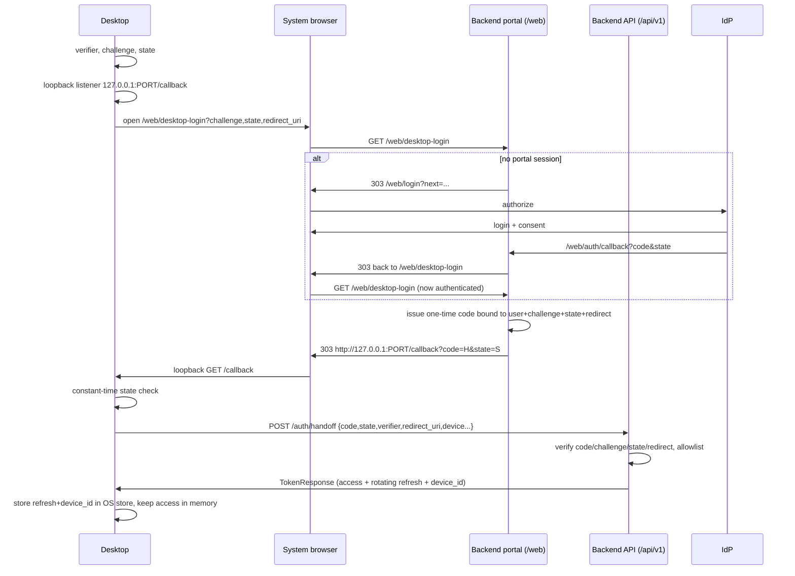

# Desktop interactive login — portal handoff specification

**Status:** implemented (backend + desktop). Change records:
`E:\ai_interview\docs\desktop-auth-handoff-changes.md` and
`docs/desktop-auth-changes.md`. The backend is a separate repo
(`E:\ai_interview`).
**Audience:** backend owner (`backend/`), desktop client (`desktop_client/`).
**Sources of truth:** `E:\ai_interview\docs\spec-v1.6.1-frozen.md` §4.5 and §11.1;
current backend code in `E:\ai_interview\backend`.

All backend paths below are relative to `E:\ai_interview` (e.g.
`backend/app/auth/routes.py`). The spec lives at
`E:\ai_interview\docs\spec-v1.6.1-frozen.md`.

---

## 1. Problem

The desktop client cannot obtain its own token pair. Today a live session
requires `DESKTOP_ACCESS_TOKEN` (and optionally `DESKTOP_REFRESH_TOKEN` +
`DESKTOP_DEVICE_ID`) to be supplied through the environment or `.env`
(`desktop_client/config.py:130-207`). There is no first-run login.

We want the "log in on our web portal" experience without the desktop reading
the portal's browser session, because that session cannot authenticate the API:

- The portal stores the platform access token in an `httponly` cookie scoped to
  the backend origin (`backend/web/auth/cookies.py:6-15`). The desktop process
  is not the browser. Only an embedded webview with cookie-store access could
  read it, which spec §4.5 explicitly forbids for the desktop
  (`docs/spec-v1.6.1-frozen.md:526`).
- The API accepts `Authorization: Bearer` only
  (`backend/app/api/dependencies.py:11-15`). No endpoint converts a web session
  into API credentials.
- The web callback discards the rotating refresh token and `device_id`
  (`backend/web/auth/routes.py:91-112`; `AuthService.login_with_oidc` returns
  them, but only `token.access_token` is stored). Handing that session to the
  desktop would produce a 60-minute dead end.

So the desktop needs a **handoff**: the portal performs the interactive login,
then gives the desktop a short-lived, one-time code that it redeems for its own
platform tokens. The desktop never sees the portal cookie or the IdP client
secret.

---

## 2. Existing pieces

| Piece | Where | State |
|---|---|---|
| Portal login (browser OIDC + cookie session) | `backend/web/auth/routes.py:21-112` | exists |
| Native PKCE authorize/token (no portal page) | `backend/app/auth/routes.py:57-145`, `backend/app/schemas/auth.py:4-35` | exists |
| Refresh rotation | `backend/app/auth/service.py:146-223`, `backend/app/auth/routes.py:147-165` | exists |
| Device + refresh registration | `backend/app/auth/service.py:113-142` | exists |
| One-time state store pattern | `backend/app/auth/routes.py:27-37` (`_OIDC_STATES`) | reusable pattern |
| Registered redirect set (exact match only) | `backend/app/core/settings.py:141-152` | **blocker, see §8** |
| Portal → desktop handoff code | — | **missing (this spec)** |

---

## 3. Proposed contract

### 3.1 `GET /web/desktop-login`

New portal route, same `user_router` tree as `/web/login` (prefix `/web`).

Query parameters:

| Parameter | Required | Notes |
|---|---:|---|
| `code_challenge` | yes | base64url(SHA-256(verifier)), no padding, 43 chars |
| `code_challenge_method` | yes | must be `S256`; anything else → `400 invalid_code_challenge_method` |
| `state` | yes | client-generated, 32–128 chars |
| `redirect_uri` | yes | desktop listener: `http://127.0.0.1:<port>/callback` (not the web callback; independent of the backend's native `OIDC_REDIRECT_URI`) |
| `scope` | no | accepted for symmetry; the portal's own login uses its fixed scope |

Behavior:

1. Validate `redirect_uri` against `settings.registered_redirect_uris` and the
   loopback rules in spec §11.1.2 (`127.0.0.1` literal, exact callback path, no
   arbitrary hosts). Reject with `400 invalid_redirect_uri`.
2. Read the `access_token` cookie itself (do **not** use
   `get_current_user_web`, which issues a redirect and loses the `next` target).
   If absent/invalid/expired, redirect `303` to
   `/web/login?next=<url-encoded current path + query>`.
3. `next` handling on `/web/login` is a small addition: validate it is a local
   path starting with `/web/` (no scheme/host) to avoid an open redirect, then
   redirect there after `/web/auth/callback` succeeds.
4. With a valid session, issue a one-time handoff code and redirect
   `303 Location: <redirect_uri>?code=<handoff>&state=<state>`.
   Never put platform tokens in the redirect.

### 3.2 Handoff code store

Mirror the existing `_OIDC_STATES` pattern, in-process (the backend refuses
`WORKER_COUNT > 1`, so process-local state is already the accepted model):

```python
# backend/app/auth/handoff.py (new)
_HANDOFF_CODES: dict[str, dict] = {}     # key = sha256_hash(code)
_MAX_HANDOFF_CODES = 1000
_HANDOFF_TTL_SECONDS = 60
_MAX_ATTEMPTS = 5
```

Record shape:

```python
{
    "user_id": str,
    "code_challenge": str,
    "code_challenge_method": "S256",
    "state": str,
    "redirect_uri": str,
    "expires_at": float,
    "attempts": int,
}
```

Rules:

- The code is opaque and high-entropy (`secrets.token_urlsafe(32)`).
- Store only `sha256_hash(code)` (`app/core/canonical.py`), matching how refresh
  tokens are stored (`app/auth/service.py:120`).
- Single use: delete the record on successful redemption.
- Expired records are evicted on every use (`_evict_expired`), and the store is
  bounded (`429 handoff_store_full`), exactly like `_OIDC_STATES`.
- Codes are bound to `user_id` + `state` + `redirect_uri` + `code_challenge`, so
  a redirect intercepted by another local process cannot be redeemed without
  the verifier.

### 3.3 `POST /api/v1/auth/handoff`

New unauthenticated API route in `app/auth/routes.py` (same router, so the
prefix is `/api/v1`).

Request:

```json
{
  "code": "handoff-code-from-portal-redirect",
  "state": "original-client-state",
  "code_verifier": "original-pkce-verifier",
  "redirect_uri": "http://127.0.0.1:8765/callback",
  "device_name": "DESKTOP-ABC",
  "platform": "windows",
  "app_version": "0.1.0"
}
```

Validation order (fail closed, generic messages):

1. Look up `sha256_hash(code)`. Unknown/expired/used → `400 invalid_handoff_code`.
2. Constant-time compare `state` → `400 invalid_state`.
3. Exact compare `redirect_uri` → `400 invalid_redirect_uri`.
4. Verify PKCE: `base64url(SHA-256(code_verifier)) == code_challenge` and
   `43 <= len(verifier) <= 128` → `400 invalid_grant` (generic; do not reveal
   which check failed). Increment `attempts`; delete the record at
   `_MAX_ATTEMPTS`.
5. Re-check the allowlist (`app/api/dependencies.py:34-43` logic) so a
   revocation between portal login and redemption is honored →
   `403 identity_not_authorized`.
6. Consume the code, register the device, issue platform tokens.

Success response: the existing `TokenResponse` shape
(`app/schemas/auth.py:24-35`), i.e. identical to
`POST /auth/{provider}/token`:

```json
{
  "access_token": "platform-access-token",
  "refresh_token": "platform-refresh-token",
  "token_type": "bearer",
  "expires_in": 3600,
  "user_id": "usr_...",
  "email": "operator@example.com",
  "display_name": "Operator",
  "device_id": "dev_..."
}
```

Refresh continues to use `POST /api/v1/auth/refresh` unchanged.

### 3.4 Sequence



---

## 4. Backend implementation notes

Map to existing code so the change stays small:

1. **Extract token issuance.** `AuthService.login_with_oidc` currently performs
   OIDC exchange, allowlist check, and device/token issuance in one method
   (`app/auth/service.py:30-142`). Add
   `AuthService.issue_for_user(db, user, *, device_name, platform, app_version)`
   containing the device/refresh block from `raw_refresh = ...` through
   `return cls._issue(...)` (`app/auth/service.py:113-142`). Keep the
   `login_success` event (`app/auth/service.py:129-141`) out of the extracted
   helper, since it logs `provider` and `oidc_subject_hash` that the handoff path
   does not have; the handoff route emits its own `login_success` with
   `provider="portal-handoff"` and no subject hash.
2. **New module** `app/auth/handoff.py` with the store from §3.2 and
   `issue_code(...)` / `redeem_code(...)` helpers.
3. **Portal route** `GET /web/desktop-login` in `web/auth/routes.py`, plus the
   `next` parameter on `/web/login` (validate local path only).
4. **API route** `POST /auth/handoff` in `app/auth/routes.py`, request schema
   `HandoffExchangeRequest` in `app/schemas/auth.py`.
5. **Rate limiting.** Global middleware is 600 requests
   (`app/main.py` `RateLimitMiddleware`). Add a per-code attempt counter (§3.2)
   and, if cheap, a per-IP counter for `/web/desktop-login`.
6. **Logging.** Emit `auth.handoff_issued` and `login_success` with
   `provider="portal-handoff"`, `device_id`, and no token/code values.

---

## 5. Security rules

- Never put an access or refresh token in a URL. The redirect carries only the
  one-time handoff code.
- The handoff code is single-use, 60 s TTL, stored hashed, bounded store.
- PKCE binding is what makes the loopback redirect safe: another local process
  that observes `code=...` still lacks the verifier.
- `state` compared with `hmac.compare_digest` (same style as
  `app/auth/routes.py:119-121`).
- `redirect_uri` must be a member of `registered_redirect_uris`; no wildcard
  hosts, no non-loopback redirects (spec §11.1.2).
- The verifier is never stored, logged, or sent to the portal — only to
  `/auth/handoff` over TLS.
- Keep the portal's login cookies as they are; the desktop never receives them.

---

## 6. Failure modes

| Failure | Behavior |
|---|---|
| No/expired portal session | `/web/desktop-login` → `303 /web/login?next=...` |
| User cancels IdP login | Portal stays on login; desktop loopback times out (30 s) and shows "login cancelled" |
| `state` mismatch at desktop | Abort, discard code, no API call |
| `state` mismatch at handoff endpoint | `400 invalid_state` |
| Code unknown/expired/used | `400 invalid_handoff_code`; desktop restarts the flow |
| PKCE verifier mismatch | `400 invalid_grant`; after 5 attempts the code is deleted |
| Redirect URI not registered | `400 invalid_redirect_uri` (portal and handoff) |
| Allowlist revoked between login and redemption | `403 identity_not_authorized`; desktop clears stored credentials |
| Backend restart between redirect and redemption | Code is lost (`_HANDOFF_CODES` is in-process) → restart the flow |
| Loopback port already bound | Desktop picks another port and restarts the flow; the new URI must still be registered |
| Callback never arrives | Desktop times out, closes the listener, clears verifier/state |

---

## 7. Desktop client changes (after the backend lands)

1. **`desktop_client/auth.py`** (new)
   - `generate_pkce()` → verifier/challenge (S256, base64url, no padding).
   - `LoopbackReceiver`: `asyncio.start_server` on `127.0.0.1`, expected path
     `/callback` only, one request, bounded headers/body, 30 s timeout.
   - `build_portal_url(settings, challenge, state)`.
   - `login(settings)` → open browser, await callback, constant-time state
     check, `POST /api/v1/auth/handoff`, return tokens.
   - Never log tokens or the verifier.
2. **`desktop_client/credentials.py`** (new)
   - `TokenStore` protocol with `load()/save()/clear()`.
   - Windows Credential Manager implementation via `keyring` (spec §11.1.7:
     refresh token + `device_id` in OS-protected storage; access token is memory
     only). Add `keyring` to `pyproject.toml` and to the PyInstaller hidden
     imports.
   - In-memory test double; no plaintext-file fallback.
3. **`config.py`**
   - Add `auth_portal_url` (default `{api_base_url}/web/desktop-login`),
     `oidc_redirect_uri`, `login_timeout_seconds`.
   - Stop treating "no `DESKTOP_ACCESS_TOKEN`" as "capture-only": env token
     remains a dev/test override, otherwise live mode comes from the stored
     credential or the browser flow.
4. **`main.py`**
   - `ensure_authenticated(settings)` before building the controller:
     env token → stored refresh + `ensure_fresh_token()` → browser login.
   - On cancel/failure fall back to the current capture-only mode with a clear
     status message; add `--no-login` for headless/dev runs.
5. **`api.py`**
   - After a successful `refresh_token()`, persist the rotated refresh token and
     `device_id` through `TokenStore` so restarts do not lose the session.
6. **Tests**
   - RFC 7636 Appendix B PKCE vector; state mismatch; loopback timeout; port in
     use; handoff error mapping; store precedence (env > stored > login); refresh
     rotation is persisted. Mock the backend with `httpx.MockTransport` and a
     local loopback server; no real IdP.

---

## 8. Decision status

Resolved and implemented:

1. **Redirect registration — backend resolved.** `settings.is_registered_redirect_uri()`
   now accepts exact registered URIs plus a narrow native loopback rule
   (literal `127.0.0.1`, registered callback path, port 1024–65535, no
   userinfo/query/fragment). Both `GET /auth/{provider}/authorize` and the OIDC
   token exchange use it. The portal handoff uses the separate
   `is_loopback_handoff_redirect()` (`/callback`, any free port), so it keeps
   working when `OIDC_REDIRECT_URI` points at a backend route (e.g. the local
   `http://127.0.0.1:8000/api/v1/auth/callback`).
2. **Endpoint choice — portal handoff chosen.** `GET /web/desktop-login` +
   `POST /api/v1/auth/handoff`.
3. **One-time code placement — process-local.** `_HANDOFF_CODES` mirrors
   `_OIDC_STATES`; a backend restart forces a new login. Redis is required only
   if `WORKER_COUNT` is ever raised.
4. **Response shape — unchanged.** `/auth/handoff` returns the existing
   `TokenResponse`, so the desktop reuses `ApiClient` and `/auth/refresh`.

Still open (not blocking the implemented flow):

5. **IdP redirect allowlist (deployment, not code).** The backend accepts
   ephemeral loopback ports, but the identity provider must also allow the
   desktop redirect — either the exact URI or a loopback rule for native
   clients. This is an IdP/tenant configuration item.
6. **Web session durability.** `/web/auth/callback` still issues only the
   access-token cookie and discards the rotating refresh token and `device_id`
   (`backend/web/auth/routes.py`). The handoff does not depend on it, but the
   web session itself still cannot refresh.
7. **`/authorize` deviations.** It still returns JSON with `authorization_url`
   instead of the spec's `302`, stores state in memory, and requires `nonce`.
   The desktop follows the JSON contract; this is unchanged by the handoff work.
8. **Device flow.** RFC 8628 remains an alternative; not implemented.

---

## 9. Alternatives considered

| Option | Why not (yet) |
|---|---|
| Read the portal's `access_token` cookie | `httponly`, origin-scoped; only an embedded webview could read it; spec §4.5 bans it |
| Have the portal page display the JWT for copy/paste | Manual, leaks tokens into history/screenshots; spec §11.1 forbids token exposure |
| Portal → desktop via custom URI scheme (`ai-interview://`) | Same handoff shape, but Windows protocol registration and hijack risk; loopback is simpler |
| Direct native PKCE (no portal page) | Works with the existing `/auth/*` endpoints; gives up the portal SSO/consent UX the user asked for |
| Device flow (RFC 8628) | Best portal-only UX but requires new backend endpoints and polling |
